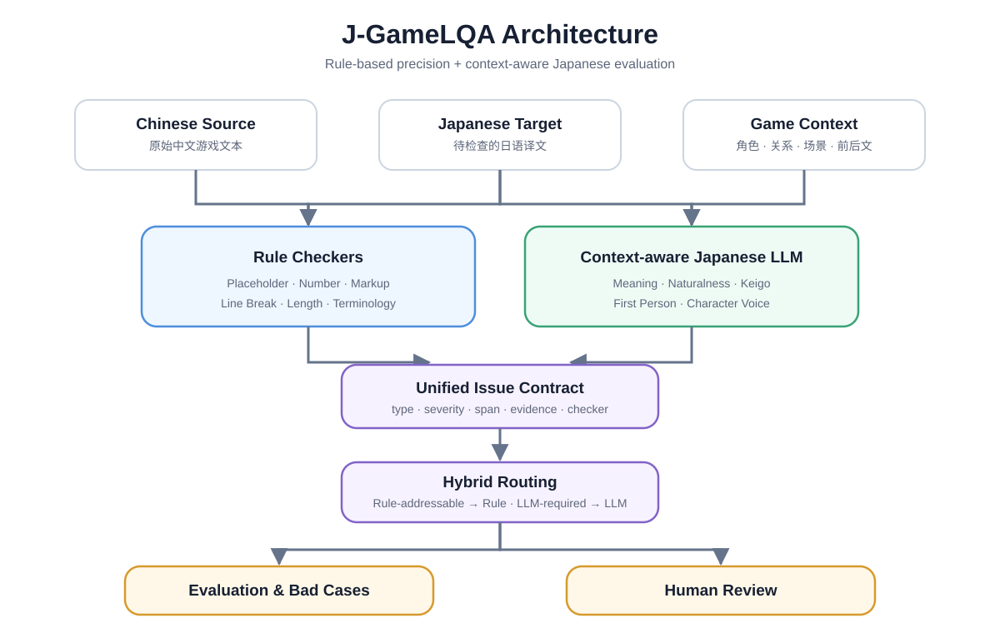

# J-GameLQA

[English](README.md) | **简体中文**

**Japanese Game Localization QA & LLM Evaluation System**

面向中文→日语游戏本地化的规则质检、上下文感知 LLM 评测与混合式 QA 系统。

J-GameLQA 不是自动翻译器。它接收中文源文、日语译文和游戏上下文，定位需要人工复核的质量问题，并用可复现的离线评测比较 Rule、LLM 与 Hybrid 三类方案。

## Problem

游戏本地化 QA 同时包含两类性质不同的问题：

- Placeholder、数字、Markup、换行、长度和术语适合确定性规则：结果稳定、证据清楚。
- 误译、漏译、翻译腔、敬语、第一人称和角色语气依赖语义与人物关系，需要上下文感知的日语 LLM。

让 LLM 包办全部检查会牺牲确定性；只用规则又看不懂语义。J-GameLQA 因此明确分工，并把两路结果统一为同一种 `Issue` 数据结构。

## Core Idea



最终 v1 候选固定为：**Rule Baseline v1 + Qwen3.5-9B + Prompt v2.1 + With Context**。Hybrid 策略不投票：Rule-addressable 类型采用 Rule 输出，LLM-required 类型采用上下文感知 LLM 输出。

> **Key held-out result**<br>
> 60 synthetic samples · 66 reference detections<br>
> Hybrid v2.1 — Precision `0.5859` · Recall `0.8788` · F1 `0.7030`<br>
> *Synthetic held-out benchmark; not production accuracy.*

## Local Demo

可选的 Streamlit 展示层允许手动输入中文原文、日语译文和人物上下文，并分别查看 Rule、LLM 与 Hybrid Issues。它直接调用现有 QA 模块，不读取 DEV/Test benchmark，也不改变冻结的 Prompt、规则或 Hybrid policy。

```powershell
python -m pip install -e ".[demo]"
ollama pull qwen3.5:9b
j-gamelqa-demo
```

没有 Ollama 时仍可使用 **Rule Only**；Hybrid QA 需要本机 Ollama 和 `qwen3.5:9b`。完整运行条件、模式和错误处理见 [Local Demo](docs/local_demo.md)。

## Architecture

| Layer | Components | Responsibility |
|---|---|---|
| Data | Development Set、Held-out Test、Glossary、Reference annotations | 分离系统输入与参考答案，控制答案泄漏 |
| Rule | Placeholder、Number、Markup、Line Break、Length、Terminology | 捕获可确定、可解释的技术错误 |
| LLM | Prompt contract、Game context、Strict JSON parser、Protocol diagnostics | 判断语义、自然度和角色关系问题，并保留原始响应 |
| Evaluation | Overall、Rule-addressable、LLM-required、Context-sensitive、Bad cases | 按 `(string_id, issue_type)` 计算检测指标并分析 FP/FN |

详细设计见 [Architecture](docs/architecture.md)，研究路径见 [Experiment Flow](docs/experiment_flow.md)。

## Evaluation Design

- **Development Set**：48 条原创 synthetic 样本、51 个 reference detections；用于 Prompt 与系统开发。
- **Held-out Test Set**：60 条独立原创 synthetic 样本、66 个 reference detections；只进行过一次最终评测，现已永久冻结。
- **Taxonomy**：15 个 Rule-addressable 类型 + 7 个 LLM-required 类型。
- **Detection key**：`(string_id, issue_type)`；Severity 与 span 在 v1 保留，但不参与匹配。
- **Diagnostics**：FP、FN、重复预测、未知类型、parse/schema/validation failures。

## Held-out Results

以下是 **60-item original synthetic held-out test set（66 reference detections）** 的第一次也是最终一次评测结果：

| Method | TP | FP | FN | Precision | Recall | F1 |
|---|---:|---:|---:|---:|---:|---:|
| Rule Only | 33 | 4 | 33 | 0.8919 | 0.5000 | 0.6408 |
| LLM Prompt v1 | 34 | 42 | 32 | 0.4474 | 0.5152 | 0.4789 |
| LLM Prompt v2.1 | 37 | 40 | 29 | 0.4805 | 0.5606 | 0.5175 |
| Hybrid Prompt v1 | 55 | 43 | 11 | 0.5612 | 0.8333 | 0.6707 |
| **Hybrid Prompt v2.1** | **58** | **41** | **8** | **0.5859** | **0.8788** | **0.7030** |

这里的 `F1 = 0.7030` 是小规模合成测试集上的 issue-detection F1，不是生产准确率。完整协议、分项指标和 bad cases 见 [Held-out Evaluation Results](docs/heldout_evaluation_results.md)。

## Why Context Matters

在 Development experiment 中，保持模型、Prompt v1、采样和解析设置不变，只加入 `speaker`、`addressee`、`scene`、`relationship`、`context_before`、`context_after`：

```text
Context-sensitive F1: 0.2857 → 0.9167
```

该分析子集只包含 `keigo_mismatch`、`first_person_mismatch` 和 `character_voice_mismatch`。它说明上下文对语用判断有明显价值，但这是开发集消融结果，不是 Held-out 或生产表现。

## Prompt Optimization Story

```text
Prompt v1
  ↓  bad-case analysis: mistranslation overprediction
Prompt v2
  ↓  added too many rules; errors shifted toward keigo and primary metrics regressed
Prompt v2.1
  ↓  minimal boundary guidance; passed pre-registered DEV candidate gates
Held-out
  Hybrid v1 F1 0.6707 → Hybrid v2.1 F1 0.7030
```

Prompt v2 被保留为有价值的负实验；v2.1 的 Held-out 优势是描述性证据，不主张统计显著。细节见 [Prompt v2 Results](docs/prompt_v2_development_results.md) 与 [Prompt v2.1 Results](docs/prompt_v21_development_results.md)。

## Important Limitations

> **这不是生产级质量声明。** 当前证据只来自原创 synthetic benchmark。

- 样本量小，且没有真实商业游戏文本。
- 没有专业双人标注、仲裁或 inter-annotator agreement（IAA）。
- LLM 假阳性仍高；Hybrid v2.1 在 10 条 Held-out clean / hard-negative 样本中误报 8 条。
- Severity 与 span 只是保留字段，尚未正式评测。
- 没有生产部署、吞吐、成本、隐私和人工工作流验证。
- 60 条 Held-out Test 已冻结并退役，不能继续用于调 Prompt、Rule 或策略。

## Quickstart

Windows PowerShell，使用 Python 3.14：

```powershell
py -3.14 -m venv .venv
.\.venv\Scripts\Activate.ps1
python -m pip install -e .
python -X utf8 -m unittest discover -s tests
python -X utf8 examples\run_rule_demo.py
```

最后一条只运行全新 demo 数据的 Rule pipeline，不调用 Ollama、不读取 reference annotations，也不覆盖正式实验产物。若只想查看已有 CLI：

```powershell
j-gamelqa-rules --help
j-gamelqa-evaluate --help
j-gamelqa-llm-evaluate --help
```

默认 Quickstart 不提供 Held-out 重跑命令；该评测已经封存。完整环境与实验设置见 [Reproducibility](docs/reproducibility.md)。

## Repository Structure

```text
j-gamelqa/
├── data/                   # DEV/Test 输入、reference annotations、glossary
├── examples/               # 不含答案的全新 synthetic Rule demo
├── docs/                   # 架构、实验、Prompt、复现与面试材料
├── src/j_gamelqa/
│   ├── rules/              # 6 类确定性 Checker
│   ├── providers/          # 可注入的本地 Ollama provider
│   ├── demo_*.py           # 可选 Streamlit 展示层与单条输入适配
│   ├── models.py           # 统一 Issue contract
│   ├── llm_evaluator.py    # Prompt → strict parser → Issue
│   ├── hybrid.py           # Rule / LLM 类型路由
│   └── evaluate.py         # Detection metrics 与 diagnostics
├── tests/                  # 无需真实 Ollama 的 unittest
├── outputs/                # 冻结的正式实验 artifacts 与 hash manifests
├── pyproject.toml
└── RELEASE_NOTES.md
```

## Documentation

- [Architecture](docs/architecture.md)：模块边界与设计取舍
- [Local Demo](docs/local_demo.md)：安装、启动、两种运行模式和已知限制
- [Experiment Flow](docs/experiment_flow.md)：从 Rule baseline 到最终 Held-out 的假设—实验—决策链
- [Portfolio One-pager](docs/portfolio_onepager.md)：一分钟项目复习页
- [Reproducibility](docs/reproducibility.md)：环境、协议、哈希与安全复现范围
- [Interview Deep-Dive](docs/interview_deep_dive.md)：16 个面试问题和三种项目介绍
- [Job Talk Tracks](docs/job_talk_tracks.md)：三类岗位的 30 秒、90 秒和深挖话术
- [中文简历版本](docs/resume_cn.md)：通用与三类岗位定制 bullet
- [Public Release Audit](docs/public_release_audit.md) 与 [GitHub Checklist](docs/github_release_checklist.md)：公开前审计和人工确认项
- [Data Schema](docs/data_schema.md) 与 [LLM Evaluator](docs/llm_evaluator.md)：字段和协议细节
- [Release Notes](RELEASE_NOTES.md)：v1 功能、结果和已知限制

## Future Work

1. 建立专业人工复核的外部 Benchmark，并加入双人标注、仲裁与 IAA。
2. 在新的 Development v2 上研究 false-positive control 与 hard-negative calibration。
3. 增加 Severity evaluation 和 span localization evaluation。
4. 在不重用已退役 Test 的前提下比较第二模型与重复运行稳定性。
5. 用获授权的真实本地化数据验证人工审核流程、成本与吞吐。

## License

This project is licensed under the MIT License. See `LICENSE`.

本项目采用 MIT License，详见 `LICENSE`。
