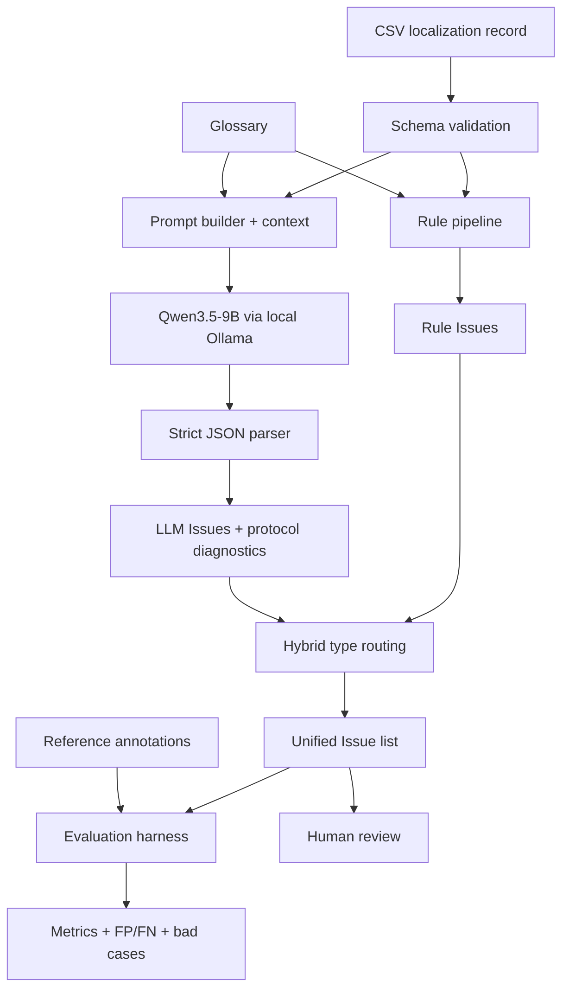

# Architecture

## Design Goal

J-GameLQA 是中文→日语游戏本地化的离线 QA 与 Evaluation 项目。输入是一条本地化记录及其游戏上下文；输出是一组结构统一、可追溯、需要人工确认的 `Issue`。系统不生成译文，也不自动改写译文。


下面的 Mermaid 保留了同一流程的可编辑版本：



## Four Layers

### 1. Data Layer

`dev.csv` 和 `test.csv` 只包含系统能看到的输入：中文源文、日语译文、文本类型、人物关系、场景、前后文和长度限制。参考答案放在独立 annotation 文件中，防止预测代码读取标签。

- Development Set：48 条、51 个 reference detections，可用于实验开发。
- Held-out Test：60 条、66 个 reference detections，只用于一次最终评价，现已冻结。
- Glossary：源术语、批准译法和禁用译法；Rule 与 Prompt 使用同一份输入。

### 2. Rule Layer

Rule pipeline 顺序调用 Placeholder、Number、Markup、Line Break、Length、Terminology 六个 Checker。一条文本可以返回多个 Issue。规则适合这些类型，因为匹配条件可以明确编码，运行稳定，而且 evidence 容易解释。

### 3. LLM Layer

LLM 层负责 `omission`、`addition`、`mistranslation`、`translationese`、`keigo_mismatch`、`first_person_mismatch` 和 `character_voice_mismatch`。Prompt v2.1 With Context 是 v1 的最终 LLM 候选。

Provider 被注入 evaluator，因此 Prompt 构造与响应解析不依赖 Ollama 实现。Parser 只接受规定字段的 JSON；非法 JSON、schema 错误、`string_id` 不一致、未知类型和重复预测都有独立 diagnostics。失败不会被静默“修好”。

### 4. Evaluation Layer

匹配键固定为 `(string_id, issue_type)`。输出包括 Overall、Rule-addressable、LLM-required、Context-sensitive、Per-Issue 指标，以及 FP/FN、重复和未知类型。Severity 与 span 在 v1 不参与评分。

## Why Rule + LLM

Rule 的优势是确定、低成本、高精度；缺点是无法理解语义和角色关系。LLM 能处理语义和语用，但容易 overpredict，也可能产生协议错误。把二者的职责按 taxonomy 分开，比让 LLM 重复判断全部技术类型更容易解释和测量。

## Why Context

敬语、第一人称和角色语气常常无法只靠一句 source/target 判断。例如，同一句普通体对童年好友可能自然，对正式场合的国王则可能失礼。v1 把 `speaker`、`addressee`、`relationship`、`scene`、`context_before`、`context_after` 作为显式输入，并用受控消融实验测量它们的作用。

## Why the Hybrid Does Not Vote

v1 Hybrid 没有置信度融合或多数投票。它采用一条可审计策略：

```text
Rule-addressable issue type → Rule output
LLM-required issue type     → LLM output
```

这样避免 LLM 覆盖高确定性的规则结果，也避免规则假装能处理语义问题。代价是 LLM-required 的高 FP 会直接进入最终输出；这是 v1 已公开的主要限制。

## Unified Issue Contract

Rule 和 LLM 最终都转换为 `Issue`：`string_id`、`checker`、`issue_type`、`severity`、`message`、source/target span、evidence 和 `needs_human_review`。统一 contract 让报告、评测和后续人工审核不必理解每个 Checker 的私有格式。

## Why Human Review Remains

本系统定位为人工 LQA 前的预检与排序，不是自动裁决器。日语自然度和人物语气存在合理分歧，Held-out 也显示 Hybrid v2.1 对 clean/hard-negative 样本误报明显。保留 raw response、evidence 和 checker 来源，是为了让审核员判断，而不是隐藏不确定性。

## Deliberate Non-goals in v1

- 自动修改或生成日语译文
- Agent / Multi-Agent 编排
- RAG、向量库或微调
- 生产 API、Web UI 和权限系统
- Severity 或 span 的正式评分

这些功能不会自动解决当前最重要的数据真实性与 false-positive 问题，因此没有被用来扩大 v1 的范围。
