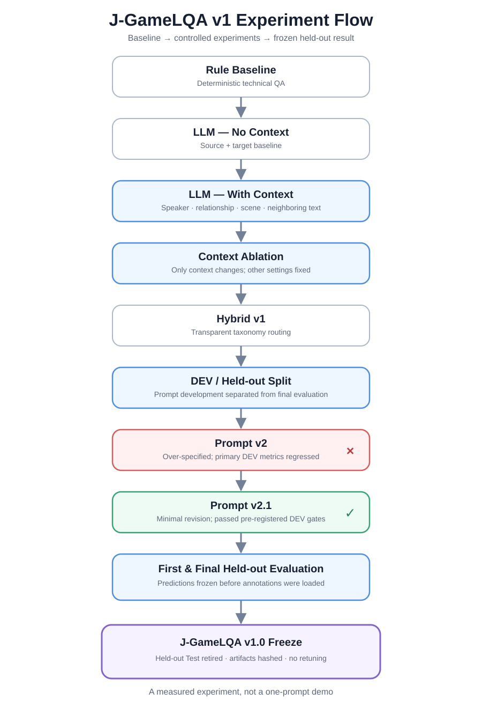

# Experiment Flow

J-GameLQA v1 不是一次 Prompt Demo，而是一条可以追溯的假设—实验—观察—决策链。

下面的 Mermaid 保留了实验路径的可编辑版本：

```mermaid
flowchart LR
    A[Rule Baseline] --> B[LLM Contract]
    B --> C[Without Context]
    C --> D[With Context]
    D --> E[Context Ablation]
    E --> F[Hybrid v1]
    F --> G[DEV / Held-out Split]
    G --> H[Prompt v2]
    H --> I[Prompt v2.1]
    I --> J[First & Final Held-out]
    J --> K[v1 Frozen]
```

## 1. Rule Baseline

- **Hypothesis**：技术性错误可以用确定性代码建立高精度基线。
- **Experiment**：实现六类 Checker，并在 synthetic Development Set 上按 detection key 评测。
- **Observation**：DEV Rule F1 为 0.6582；Held-out F1 为 0.6408。Precision 高，Recall 受无法理解语义限制。
- **Decision**：保留 Rule 作为技术错误权威来源，而不是用 LLM 替换。

## 2. LLM Contract

- **Hypothesis**：在比较模型质量前，先固定输入、taxonomy、输出 schema 和失败处理，才能区分语义失败与协议失败。
- **Experiment**：建立 provider-neutral Prompt builder、严格 JSON parser、统一 Issue 和 protocol diagnostics；no retry/no repair。
- **Observation**：真实实验能独立报告 provider、parse、schema、validation 与 duplicate 情况。
- **Decision**：后续 Prompt 只能在同一 contract 下受控比较。

## 3. Without Context Baseline

- **Hypothesis**：只给 source/target 的 LLM 可以判断部分语义错误，但语用类问题会受限。
- **Experiment**：Qwen3.5-9B、Prompt v1、temperature 0、thinking off，运行 48 条 DEV。
- **Observation**：Overall F1 0.5376，LLM-required F1 0.4906；context-sensitive F1 只有 0.2857。
- **Decision**：把 Context 作为唯一变量做下一轮实验。

## 4. With Context and Ablation

- **Hypothesis**：人物、关系、场景与前后文能改善敬语、第一人称和角色语气判断。
- **Experiment**：模型、Prompt 与运行参数不变，只加入六个上下文字段。
- **Observation**：Overall F1 0.6602，LLM-required F1 0.7302；context-sensitive F1 从 0.2857 升至 0.9167，同时也产生新 FP 和个别回退。
- **Decision**：最终候选使用 With Context，但不把 Context 描述成无副作用提升。

## 5. Hybrid v1

- **Hypothesis**：按问题类型路由能同时保留 Rule precision 和 LLM semantic recall。
- **Experiment**：Rule-addressable 取 Rule，LLM-required 取 Prompt v1 With Context。
- **Observation**：DEV Hybrid F1 0.8376，高于两个单独系统。
- **Decision**：冻结简单、透明的 Hybrid policy，不引入 voting 或权重。

## 6. DEV / Held-out Split

- **Hypothesis**：继续只看同一批开发数据会高估系统泛化。
- **Experiment**：冻结 48 条 DEV，另建 60 条原创 synthetic Held-out；检查 schema、coverage 和 DEV/Test exact leakage。
- **Observation**：Held-out 含 66 个 reference detections、10 个 clean/hard negatives、16 个 multi-issue samples。
- **Decision**：Prompt 调整只看 DEV；Test 在候选和评价协议预注册后才打开。

## 7. Prompt v2 Negative Experiment

- **Hypothesis**：更详细的边界规则可减少 `mistranslation` overprediction。
- **Experiment**：在同一 DEV 和运行条件下加入较多判定规则。
- **Observation**：`mistranslation` 边界改善，但错误迁移到 keigo，LLM-required F1 从 0.7302 降到 0.6774，Hybrid F1 从 0.8376 降到 0.8103。
- **Decision**：拒绝 v2，不让它消耗 Held-out 暴露预算；保留为负实验。

## 8. Prompt v2.1 Minimal Revision

- **Hypothesis**：只修最清楚的边界与证据纪律，比堆规则更稳健。
- **Experiment**：在 frozen v1 上做最小附加说明，并预注册 candidate gates。
- **Observation**：DEV LLM-required F1 0.7541，Hybrid F1 0.8522，通过全部 gates，协议成功率 100%。
- **Decision**：v1 与 v2.1 成为仅有的两个 Held-out LLM candidates。

## 9. First and Final Held-out Evaluation

- **Hypothesis**：v2.1 在 DEV 的改善能否转移到未参与调优的数据。
- **Experiment**：先生成并哈希全部 Rule/v1/v2.1 predictions，之后才加载 annotations；评价五个预注册方法。
- **Observation**：Hybrid v2.1 F1 0.7030，高于 Hybrid v1 的 0.6707，但 DEV→Test 差距为 -0.1491，且 clean/hard-negative sample false-alarm rate 为 80%。
- **Decision**：选择 Hybrid v2.1 作为 v1 最终候选，同时冻结并退役该 Test，不再用结果调系统。

## What This Flow Demonstrates

项目的核心不是“某一次分数”，而是：建立 baseline、控制单一变量、承认负实验、预注册候选、隔离 annotations、封存 artifacts，并用 bad cases 解释 Precision/Recall trade-off。
